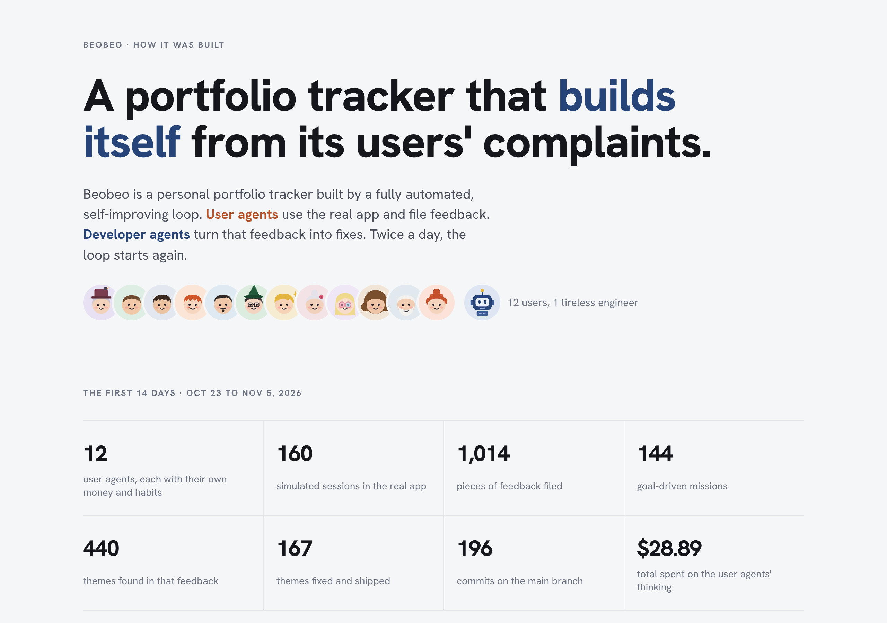

# Beobeo

A personal portfolio tracker built via a fully automated self-improving loop: user agents test the app and file feedback, developer agents implement fixes.

**[How the loop works →](https://salarabb.github.io/beobeo/)**

[](https://salarabb.github.io/beobeo/)

## The app

Beobeo tracks stocks, ETFs, funds and crypto across accounts and portfolios.

- **Dashboard:** what you've put in, what it's worth, gain on holdings, net gain from sales this year, and one suggested next buy for the money you're adding.
- **Holdings:** every purchase, its cost, and when it turns long-term. Each account can match sales oldest-first or highest-cost-first.
- **Tax Center:** a deterministic tax-lot engine (no LLM) that shows the tax a sale would cost, losses you can harvest, wash-sale traps, and room for gains taxed at 0%.
- **Compare:** would the same dollars, on the same days, have done better in SPY or another benchmark?
- **Chat:** an assistant that answers from your own portfolio data with read-only tools. Its numbers match the pages.
- **Import:** Robinhood, Coinbase and generic CSV files, with duplicate rows skipped. Unknown formats are mapped by AI from the header and a few rows only.

Beobeo shows analysis of your own data. It is not financial or tax advice.

## The loop

Twelve simulated investors, each with their own money, habits, tax situation and temperament, use the real app in Chrome on real market prices. Every click, wait, answer and complaint goes into a local journal. Twice a day the feedback is grouped into ranked themes. Then headless Claude Code agents build the top fixes on branches, verify them (types, lint, tests, build and screenshots) and merge what passes. The next cycle's investors meet the changed app.

The details are on [the loop page](https://salarabb.github.io/beobeo/) (source in `site/`) and in [PLAN.md](PLAN.md). For the rules the agents work under, see [CLAUDE.md](CLAUDE.md).

## Stack

Next.js 16 (App Router, React 19), tRPC v11, TanStack Query, Tailwind v4 and shadcn/ui · Postgres (Neon) with Drizzle · Better Auth · decimal.js for all money math · lightweight-charts and Recharts · the Anthropic SDK for the chat agent and the simulated investors · Playwright and `node:sqlite` for the simulation · Vitest · pnpm workspaces with Turborepo.

```
apps/web               Next.js app: pages, tRPC routers, server-side assembly
packages/core          pure TypeScript engine: lots, gains, time series, metrics, tax
packages/db            Drizzle schema, client, seed
packages/market-data   price providers (Tiingo, Alpha Vantage, Coinbase, CoinGecko) over a price cache
packages/importers     CSV presets and parsing (runs in the browser)
packages/agent         chat agent and its tools (never touches the database)
packages/sim           simulated investors, missions, journal, digest, report
scripts/               the evolve cycle and its launchd schedule
```

## Run it locally

Requirements: Node 26, pnpm 11, a Postgres database (a free Neon project works), and a [Tiingo](https://www.tiingo.com) API key for stock prices. Crypto prices need no key.

```sh
pnpm install
cp .env.example .env              # fill in DATABASE_URL, BETTER_AUTH_SECRET, BETTER_AUTH_URL, TIINGO_API_KEY
ln -s ../../.env apps/web/.env    # Next.js reads env from the app directory
pnpm db:push                      # create the schema
pnpm db:seed                      # demo user: demo@beobeo.dev / demo-password-123
pnpm dev                          # http://localhost:3000
```

`ANTHROPIC_API_KEY` is optional. It turns on the chat assistant, AI mapping of unknown CSV formats, and the simulation.

```sh
pnpm typecheck && pnpm lint && pnpm test && pnpm build   # full check
```

### Running the simulation yourself

```sh
pnpm sim:bootstrap      # create the simulated investors and replay their history (no LLM)
pnpm sim:day            # one simulated day against the running app
pnpm sim:digest         # ranked themes → ~/beobeo-sim/digests/
pnpm sim:report         # the evolution site
pnpm evolve             # one full cycle: simulate, digest, build rounds, check, merge
```

The investors' LLM spend is capped at `SIM_DAILY_BUDGET_USD` (default $5 a day). A full cycle also runs Claude Code rounds, which cost extra, so run `pnpm evolve` deliberately.

## License

[MIT](LICENSE) © 2026 Salar Abbaspour
